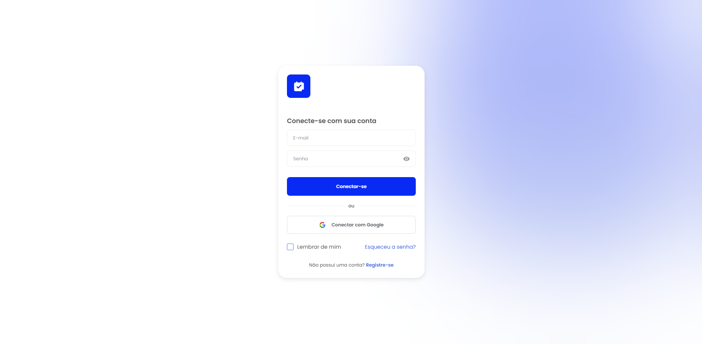
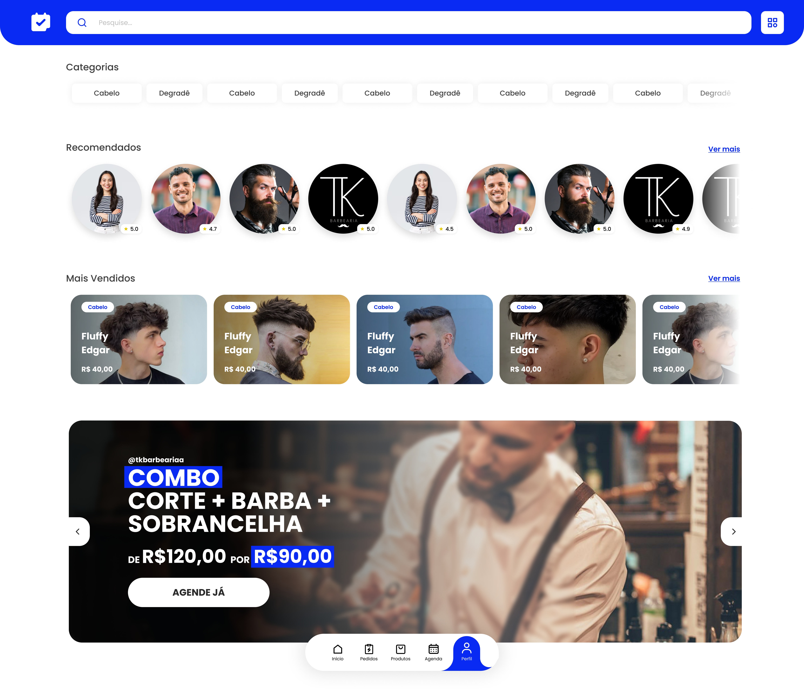
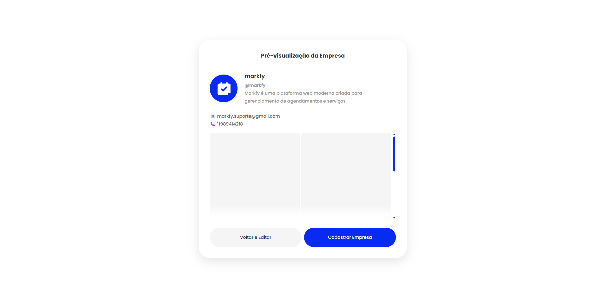
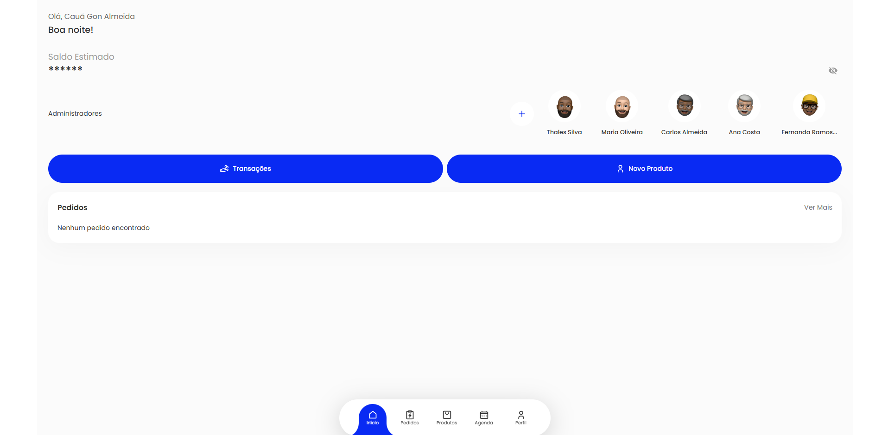
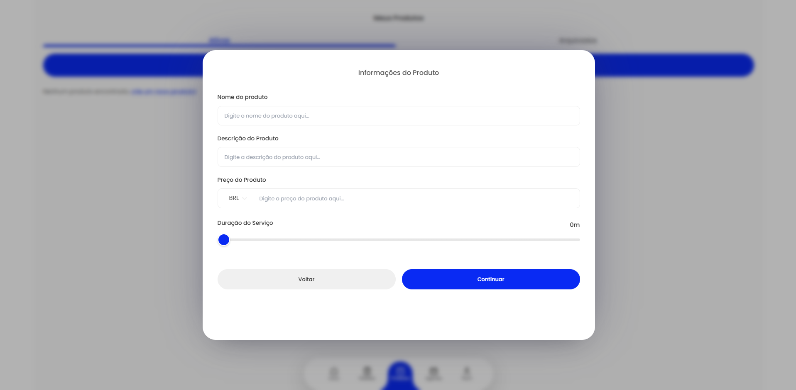

# Markfy

**Markfy** é uma plataforma web moderna criada para **gerenciamento de agendamentos e serviços**, desenvolvida para atender diferentes tipos de negócios como **barbearias, clínicas, designers, salões de beleza e prestadores de serviço em geral**.

O sistema foi projetado com foco em **automação, organização e facilidade de uso**, permitindo que cada empresa **crie e personalize sua própria estrutura de atendimento**, mantendo controle completo sobre seus serviços, profissionais e agendamentos.

A Markfy também conecta **clientes e empresas**, permitindo que usuários encontrem serviços próximos, agendem horários e acompanhem seus compromissos de forma simples e rápida.

Além disso, a plataforma foi projetada seguindo princípios de **design responsivo**, garantindo uma experiência consistente e otimizada em diferentes dispositivos, como **smartphones, tablets e desktops**.

---

# 🚀 Funcionalidades

## 🏢 Para Empresas / Administradores

- Criação e personalização da própria empresa
- Adição de **administradores**
- Gerenciamento de **produtos e serviços**
- Criação de **promoções**
- Visualização do **calendário de agendamentos**
- Gestão completa de clientes
- Configuração de **WhatsApp para contato**
- Personalização da empresa conforme a necessidade do negócio
- Controle de serviços oferecidos e profissionais disponíveis

O sistema foi desenvolvido para permitir que **cada empresa tenha sua própria estrutura**, podendo organizar seus serviços da forma que preferir.

---

## 👤 Para Usuários / Clientes

Usuários comuns podem utilizar a plataforma para encontrar e agendar serviços.

Funcionalidades incluem:

- Criar **perfil próprio**
- **Buscar empresas** próximas (ex: barbearias, designers, clínicas, etc)
- **Agendar serviços**
- Escolher **profissional de preferência**
- Visualizar **histórico de agendamentos**
- Conectar conta utilizando **Google**
- Gerenciar suas informações pessoais

---

# ⚡ Conceito da Plataforma

A **Markfy foi construída com foco em automação e praticidade**, tanto para empresas quanto para clientes.

A interface foi inspirada em plataformas modernas utilizadas no dia a dia, como:

- Instagram
- TikTok
- Google

Isso permite que o usuário tenha uma **experiência familiar e intuitiva**, reduzindo a curva de aprendizado.

Além disso, o design foi pensado para **funcionar perfeitamente em dispositivos móveis**, já que grande parte dos agendamentos hoje são feitos diretamente pelo celular.

Mesmo seguindo referências modernas, o sistema mantém **identidade própria, organização e profissionalismo**, garantindo escalabilidade e crescimento do projeto.

---

# 🧠 Arquitetura e Organização

Durante o desenvolvimento da Markfy foram seguidos princípios importantes como:

- Organização modular do código
- Componentização
- Boas práticas de identação
- Estrutura pensada para **crescimento da aplicação**
- Separação clara entre lógica, interface e serviços
- Interface responsiva pensada para **mobile-first**

Isso permite que o projeto seja **facilmente expandido no futuro** com novos recursos.

---

# 💻 Tecnologias Utilizadas

- **React.js**  
Framework JavaScript utilizado para construir a interface da aplicação de forma dinâmica e moderna.

- **Node.js**  
Ambiente de execução JavaScript utilizado para serviços e integrações.

- **CSS3**  
Responsável pela estilização da aplicação e estrutura visual da interface, incluindo a implementação da responsividade para diferentes dispositivos.

- **Firebase**  
Utilizado para serviços em nuvem como:
  - autenticação de usuários
  - banco de dados
  - armazenamento de informações da aplicação

- **EmailJS**  
Utilizado para envio de e-mails automáticos, como notificações e validações de conta.

---

# 📷 Interface da Plataforma

Abaixo estão alguns exemplos de telas da aplicação.

## 🔐 Login

Interface de autenticação para acesso dos usuários e administradores.



---

## 🏠 Home

Tela inicial da plataforma onde os usuários podem explorar empresas e serviços.



---

## 🏢 Criação de Empresa

Interface onde um usuário pode criar e configurar sua própria empresa dentro da plataforma.



---

## ⚙️ Gerenciamento da Empresa

Painel administrativo onde é possível gerenciar serviços, profissionais, promoções e agendamentos.



---

## 📦 Criação de Produtos / Serviços

Interface para criação e gerenciamento dos serviços oferecidos pela empresa.



---

# ⚙️ Como Rodar o Projeto

1. Clone o repositório

```bash
git clone https://github.com/caua-almeida1/markfy.git
```

2. Entre na pasta do projeto

```bash
cd .\react-firebase-auth-boilerplate-main\
```

3. Instale as dependências
   
```bash
npm install
```

4. Inicie a aplicação

```bash
npm start
```

A aplicação estará disponível em:

```bash
http://localhost:3000
```
